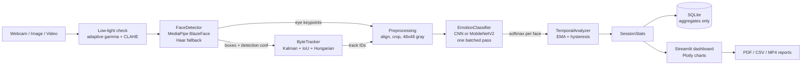

<p align="center"></p>

<h1 align="center">EmotionLens AI</h1>
<p align="center"><b>Intelligent facial expression recognition, multi-face tracking and real-time analytics</b></p>

<p align="center">
Python 3.11 · TensorFlow/Keras · OpenCV · MediaPipe · ByteTrack · Streamlit · Plotly · SQLite
</p>

> **Ethics note.** EmotionLens AI classifies *visible facial expressions* into seven categories.
> A predicted label is **not** a measurement of anyone's actual emotional or psychological state.
> No face images or biometric embeddings are stored. Only aggregate statistics are kept.

---

## Features

| | |
|---|---|
| **Real-time recognition** | Webcam capture, multi-face detection, per-face label + confidence, frame skipping, batched inference, FPS monitor |
| **Multi-face tracking** | ByteTrack (Kalman filter + IoU + Hungarian matching) with persistent IDs, occlusion recovery and low-score rescue |
| **Temporal analysis** | EMA / moving-window smoothing, hysteresis-based expression-change events, stability score, time-in-expression |
| **Image analysis** | Every face labelled, top-3 probabilities, PDF / CSV / annotated PNG export |
| **Video analysis** | MP4/AVI frame-by-frame tracking, processed video export, timeline charts, PDF/JSON summary |
| **Analytics dashboard** | KPI cards, distributions, frequency over time, per-track history, confidence histogram, filters |
| **Session management** | SQLite persistence of aggregates, per-session and bulk deletion |
| **Research** | Custom CNN vs MobileNetV2, confusion matrices, latency, lighting robustness, smoothing and ablation experiments |
| **Engineering** | Low-light enhancement, eye-based face alignment, MediaPipe→Haar fallback, CPU/GPU detection, logging, configurable thresholds |

Two kinds of confidence are always reported separately:
- **Detection confidence**: how sure the face detector is that the box contains a face.
- **Expression confidence**: the classifier's softmax probability for the predicted expression.

## Architecture



Details: [docs/ARCHITECTURE.md](docs/ARCHITECTURE.md)

## Project structure

```
EmotionLens-AI/
├── app.py                      # Streamlit entry point (sidebar navigation, 8 pages)
├── config.py                   # paths, labels, training defaults, AppSettings
├── requirements.txt
├── models/
│   ├── cnn_model.py            # custom CNN + MobileNetV2 transfer model
│   ├── data.py                 # load prepared arrays, tf.data pipelines
│   ├── train.py                # training CLI (callbacks, class weights, timing)
│   ├── evaluate.py             # test metrics, confusion matrix, latency, comparison table
│   └── checkpoints/            # trained .keras models (created by train.py)
├── detection/
│   ├── face_detector.py        # MediaPipe / Haar detector
│   ├── face_tracker.py         # ByteTrack implementation
│   └── preprocessing.py        # alignment, crop, low-light handling
├── recognition/
│   ├── emotion_classifier.py   # model loading + batched tf.function inference
│   ├── temporal_analyzer.py    # smoothing, change detection, stability
│   └── pipeline.py             # FrameProcessor: detector → tracker → classifier → temporal
├── analytics/
│   ├── session.py              # per-session statistics
│   ├── charts.py               # Plotly figures
│   ├── dashboard.py            # UI components (CSS, KPI cards)
│   └── report_generator.py     # PDF / CSV / JSON exports
├── database/
│   ├── schema.sql
│   └── db_manager.py
├── ui/                         # one module per dashboard page
├── utils/                      # logger, device detection, image & video helpers
├── scripts/
│   ├── check_environment.py
│   ├── prepare_dataset.py
│   └── run_experiments.py
├── tests/                      # pytest suite (no GPU or camera needed)
├── docs/                       # architecture, demo workflow, interview prep
└── .streamlit/config.toml      # dark theme
```

## Requirements

- Windows 10/11, macOS or Linux, 64-bit
- **Python 3.11** (3.12 also works; 3.13+ is not supported by TensorFlow 2.17 / MediaPipe 0.10.21)
- 8 GB RAM minimum, 16 GB recommended; a webcam for live mode
- Windows only: [Microsoft Visual C++ Redistributable x64](https://aka.ms/vs/17/release/vc_redist.x64.exe)
- No GPU required (TensorFlow ≥ 2.11 has no native-Windows GPU support; everything runs on CPU)

## Installation (Windows PowerShell)

```powershell
# 1. Python 3.11 (via the Python install manager, or python.org installer)
py install 3.11

# 2. Virtual environment inside the project folder
cd $HOME\Documents\EmotionLens-AI
py -V:3.11 -m venv .venv
.\.venv\Scripts\Activate.ps1          # if blocked: Set-ExecutionPolicy -Scope CurrentUser RemoteSigned

# 3. Dependencies
python -m pip install --upgrade pip
pip install -r requirements.txt

# 4. Sanity checks
python -m scripts.check_environment
python -m pytest tests -v
```

macOS/Linux: `python3.11 -m venv .venv && source .venv/bin/activate`, then the same pip/pytest commands.

## Dataset

FER-2013 (48×48 grayscale faces, 7 classes, ~35k images). Download it from Kaggle
([msambare/fer2013](https://www.kaggle.com/datasets/msambare/fer2013)) and extract so that you have:

```
data/raw/fer2013/train/<angry|disgust|fear|happy|neutral|sad|surprise>/*.png
data/raw/fer2013/test/<...same 7 folders...>/*.png
```

The original `fer2013.csv` also works (put it anywhere under `data/raw/`). The dataset is **not** committed to Git.

```powershell
python -m scripts.prepare_dataset
```

This cleans the training split (blank images, duplicates, train/test leakage), creates a stratified
validation split, computes balanced class weights and writes `data/processed/fer2013.npz`.

## Training and evaluation

```powershell
python -m models.train --model cnn --epochs 3 --limit 3000   # 2-minute smoke test (optional)
python -m models.train --model cnn                            # custom CNN
python -m models.train --model mobilenet                      # MobileNetV2 transfer learning (slower)
python -m models.evaluate                                     # metrics + comparison table
python -m scripts.run_experiments all                         # research experiments
```

Optional ablations:

```powershell
python -m models.train --model cnn --no-augment --name cnn_noaug
python -m models.train --model cnn --no-class-weights --name cnn_noweights
python -m models.evaluate
python -m scripts.run_experiments ablation
```

Training writes `models/checkpoints/<name>.keras`, `<name>_history.csv` and `<name>_meta.json`
(with the measured training time). Evaluation writes `reports/experiments/eval_<name>.json`,
`model_comparison.csv/.md` and figures in `reports/figures/`.

## Results

All results are generated on your machine by the commands above. After running them, copy the
contents of `reports/experiments/model_comparison.md` here.

<!-- RESULTS-TABLE: paste reports/experiments/model_comparison.md -->
_Not yet generated. Run training and `python -m models.evaluate`._

## Run the app

```powershell
streamlit run app.py
```

Open http://localhost:8501. Pages: Home Dashboard · Live Webcam Detection · Image Analysis · Video
Analysis · Expression Analytics · Model Performance · Session History · Settings.

## Testing

```powershell
python -m pytest tests -v
```

The suite covers dataset preparation, ByteTrack (ID persistence, occlusion recovery, low-score
rescue), temporal smoothing/hysteresis, alignment geometry, low-light enhancement, SQLite CRUD with
cascading deletes, session statistics and PDF generation. It needs no camera, GPU or trained model.

## Privacy

- No face images, crops or embeddings are written to disk or to the database.
- Tracking uses box geometry only (no appearance features).
- The database stores counts, confidences, durations and anonymous integer track IDs.
- Uploaded images/videos are processed in memory or temporary files that are deleted afterwards.
- Every session can be deleted from **Session History**.

## Limitations

FER-2013 is low-resolution, noisy (label noise is well documented), posed/web-sourced, and skewed in
demographics and in class frequency (*Disgust* is rare). Models trained on it generalise imperfectly
to real webcam footage, to non-frontal faces and across demographic groups. Expression ≠ emotion: a
smile can be social, and many emotions show no visible expression. See
[docs/ARCHITECTURE.md](docs/ARCHITECTURE.md#limitations-and-fairness).

## Documentation

- [Architecture & technical documentation](docs/ARCHITECTURE.md)
- [Demo workflow](docs/DEMO_WORKFLOW.md)
- [Interview preparation](docs/INTERVIEW_PREP.md)

## Troubleshooting

| Problem | Fix |
|---|---|
| `No matching distribution found for tensorflow` | You are on Python 3.13+ or 32-bit. Create the venv with `py -V:3.11` |
| `DLL load failed` importing TensorFlow / MediaPipe | Install the VC++ Redistributable x64, then restart the terminal |
| `cv2` errors after installing | `pip uninstall -y opencv-python opencv-python-headless` then `pip install --force-reinstall opencv-contrib-python==4.10.0.84` |
| Webcam does not open | Close Teams/Zoom/Camera app; allow desktop apps in *Settings → Privacy & security → Camera*; try camera index 1 |
| "No trained model found" in the app | Run `python -m models.train --model cnn` |
| Processed video does not preview in the browser | Your OpenCV build lacks H.264; download the MP4 and play it locally |
| `Activate.ps1 cannot be loaded` | `Set-ExecutionPolicy -Scope CurrentUser RemoteSigned` |

## Acknowledgements

FER-2013 (Goodfellow et al., 2013, ICML Challenges in Representation Learning) · ByteTrack
(Zhang et al., ECCV 2022) · MobileNetV2 (Sandler et al., CVPR 2018) · MediaPipe BlazeFace
(Bazarevsky et al., 2019).
