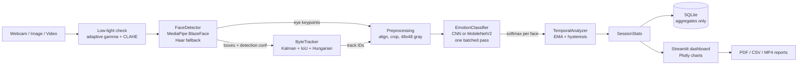
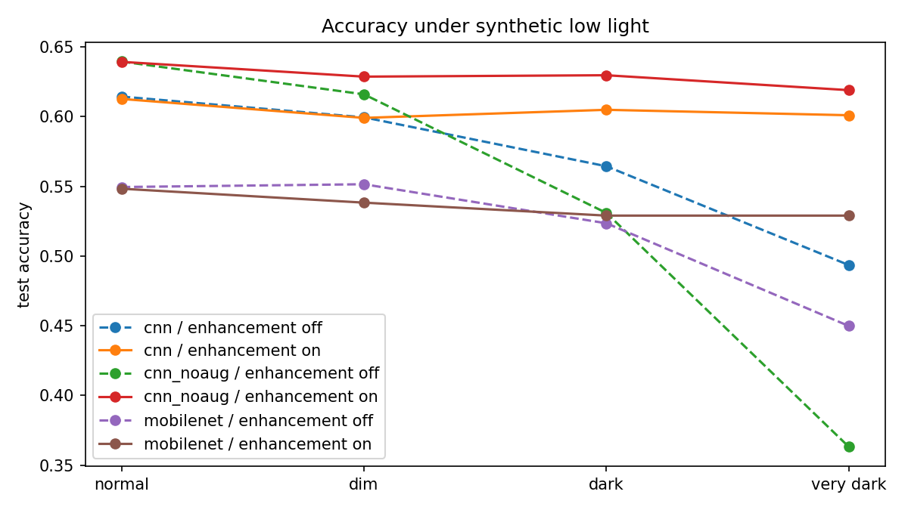
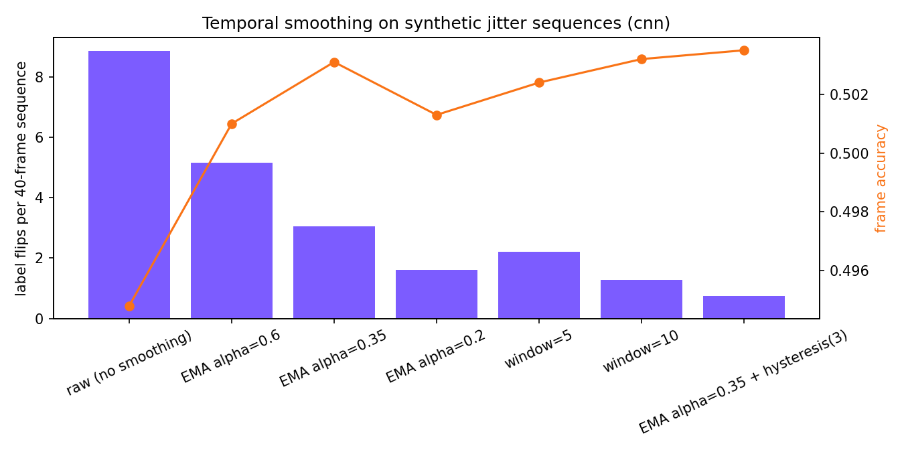
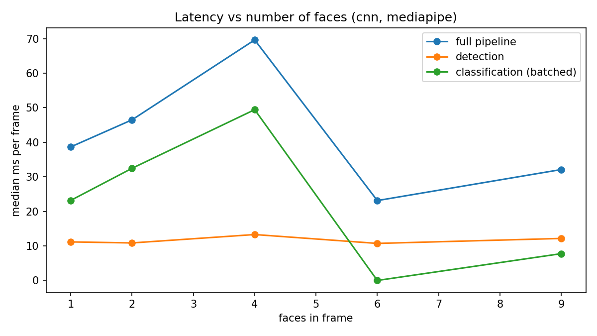
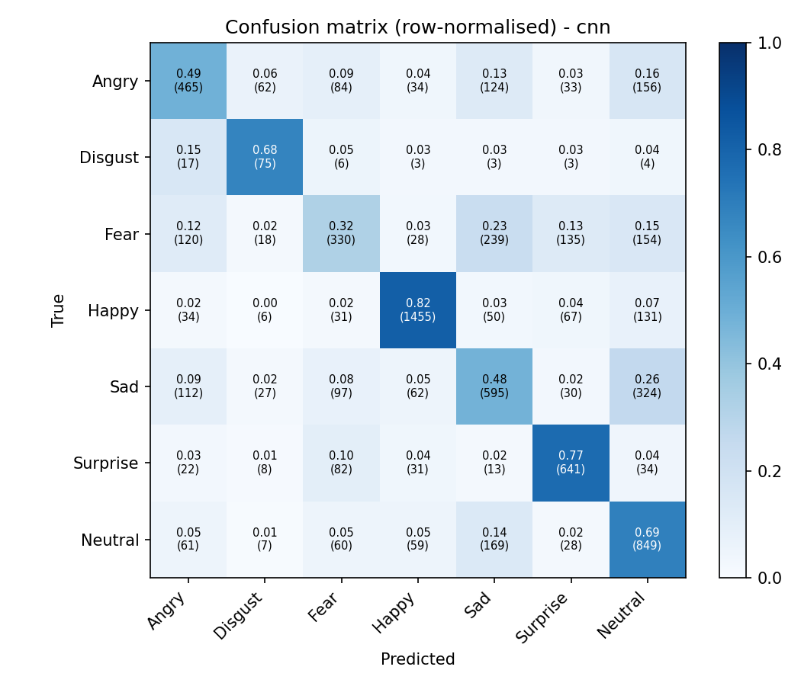
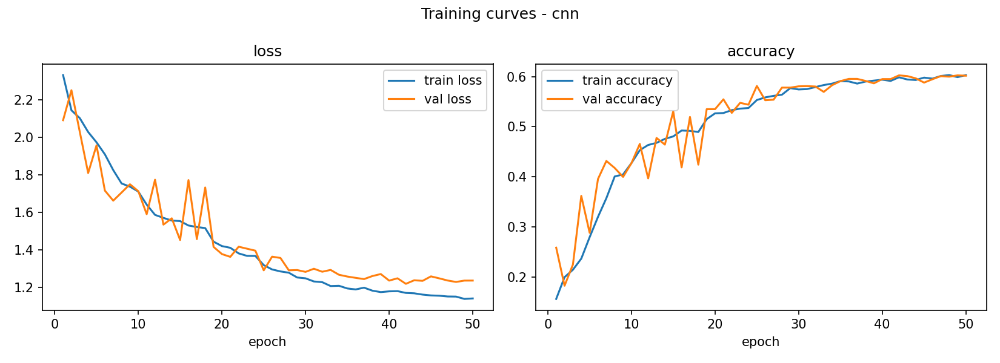

<p align="center"></p>

<h1 align="center">EmotionLens AI</h1>
<p align="center"><b>Intelligent facial expression recognition, multi-face tracking and real-time analytics</b></p>

<p align="center">
Python 3.11 · TensorFlow/Keras (training) · ONNX Runtime (inference) · OpenCV · MediaPipe · ByteTrack · Streamlit · Plotly · SQLite
</p>

> **Ethics note.** EmotionLens AI classifies *visible facial expressions* into seven categories.
> A predicted label is **not** a measurement of anyone's actual emotional or psychological state.
> No face images or biometric embeddings are stored. Only aggregate statistics are kept.

---

## Features

| | |
|---|---|
| **Real-time recognition** | Webcam capture, multi-face detection, per-face label + confidence, frame skipping, batched inference, FPS monitor |
| **Multi-face tracking** | ByteTrack (Kalman filter + IoU + Hungarian matching) with persistent IDs, occlusion recovery and low-score rescue |
| **Temporal analysis** | EMA / moving-window smoothing, hysteresis-based expression-change events, stability score, time-in-expression |
| **Image analysis** | Every face labelled, top-3 probabilities, PDF / CSV / annotated PNG export |
| **Video analysis** | MP4/AVI frame-by-frame tracking, processed video export, timeline charts, PDF/JSON summary |
| **Analytics dashboard** | KPI cards, distributions, frequency over time, per-track history, confidence histogram, filters |
| **Session management** | SQLite persistence of aggregates, per-session and bulk deletion |
| **Research** | Custom CNN vs MobileNetV2, confusion matrices, latency, lighting robustness, smoothing and ablation experiments |
| **Engineering** | Low-light enhancement, eye-based face alignment, MediaPipe→Haar fallback, CPU/GPU detection, logging, configurable thresholds |

Two kinds of confidence are always reported separately:
- **Detection confidence**: how sure the face detector is that the box contains a face.
- **Expression confidence**: the classifier's softmax probability for the predicted expression.

## Architecture



Details: [docs/ARCHITECTURE.md](docs/ARCHITECTURE.md)

## Project structure

```
EmotionLens-AI/
├── app.py                      # Streamlit entry point (sidebar navigation, 8 pages)
├── config.py                   # paths, labels, training defaults, AppSettings
├── requirements.txt            # laptop: app + ONNX Runtime (no TensorFlow)
├── requirements-train.txt      # Colab/Linux: TensorFlow, tf2onnx
├── notebooks/train_colab.ipynb # GPU training + ONNX export (generated by scripts/make_notebook.py)
├── models/
│   ├── cnn_model.py            # custom CNN + MobileNetV2 transfer model
│   ├── data.py                 # load prepared arrays, tf.data pipelines
│   ├── train.py                # training CLI (callbacks, class weights, timing)
│   ├── evaluate.py             # test metrics, confusion matrix, latency, comparison table
│   ├── export_onnx.py          # .keras -> inference copy (no augmentation) -> ONNX, verified
│   └── checkpoints/            # trained .keras models (created by train.py)
├── detection/
│   ├── face_detector.py        # MediaPipe / Haar detector
│   ├── face_tracker.py         # ByteTrack implementation
│   └── preprocessing.py        # alignment, crop, low-light handling
├── recognition/
│   ├── emotion_classifier.py   # model loading + batched tf.function inference
│   ├── temporal_analyzer.py    # smoothing, change detection, stability
│   └── pipeline.py             # FrameProcessor: detector → tracker → classifier → temporal
├── analytics/
│   ├── session.py              # per-session statistics
│   ├── charts.py               # Plotly figures
│   ├── dashboard.py            # UI components (CSS, KPI cards)
│   └── report_generator.py     # PDF / CSV / JSON exports
├── database/
│   ├── schema.sql
│   └── db_manager.py
├── ui/                         # one module per dashboard page
├── utils/                      # logger, device detection, image & video helpers
├── scripts/
│   ├── check_environment.py
│   ├── prepare_dataset.py
│   └── run_experiments.py
├── tests/                      # pytest suite (no GPU or camera needed)
├── docs/                       # architecture, demo workflow, interview prep
└── .streamlit/config.toml      # dark theme
```

## Requirements

- Windows 10/11, macOS or Linux, 64-bit
- **Python 3.11** (3.12 also works; 3.13+ is not supported by MediaPipe 0.10.21)
- 8 GB RAM minimum, 16 GB recommended; a webcam for live mode
- Windows only: [Microsoft Visual C++ Redistributable x64](https://aka.ms/vs/17/release/vc_redist.x64.exe)
- No GPU required on the laptop. Training runs on a free Google Colab GPU.

### Training on Colab, inference with ONNX Runtime

The laptop never needs TensorFlow. Models are trained in Colab (`notebooks/train_colab.ipynb`),
exported to **ONNX**, and the app runs them with **ONNX Runtime**. Real hardware forced this choice:
on Windows 11 with **Smart App Control** enabled, TensorFlow's unsigned DLLs are blocked
("An Application Control policy has blocked this file"), while ONNX Runtime's Microsoft-signed DLLs
load normally. It is also a sound deployment pattern in general (train with a full framework, serve a
lightweight runtime). Two more Smart App Control workarounds are pinned in `requirements.txt`:
`pyarrow==18.1.0` (newer builds are blocked) and pure-Python `fonttools`. `utils/native_preload.py`
fixes a DLL load-order conflict between pyarrow's bundled MSVC runtime and MediaPipe.

## Installation (Windows PowerShell)

```powershell
# 1. Python 3.11 (via the Python install manager, or python.org installer)
py install 3.11

# 2. Virtual environment inside the project folder
cd $HOME\Documents\EmotionLens-AI
py -V:3.11 -m venv .venv
.\.venv\Scripts\Activate.ps1          # if blocked: Set-ExecutionPolicy -Scope CurrentUser RemoteSigned

# 3. Dependencies
python -m pip install --upgrade pip
pip install -r requirements.txt

# 4. Sanity checks
python -m scripts.check_environment
python -m pytest tests -v
```

macOS/Linux: `python3.11 -m venv .venv && source .venv/bin/activate`, then the same pip/pytest commands.

## Dataset

FER-2013 (48×48 grayscale faces, 7 classes, ~35k images). Download it from Kaggle
([msambare/fer2013](https://www.kaggle.com/datasets/msambare/fer2013)) and extract so that you have:

```
data/raw/fer2013/train/<angry|disgust|fear|happy|neutral|sad|surprise>/*.png
data/raw/fer2013/test/<...same 7 folders...>/*.png
```

The original `fer2013.csv` also works (put it anywhere under `data/raw/`). The dataset is **not** committed to Git.

```powershell
python -m scripts.prepare_dataset
```

The Colab notebook downloads and prepares the dataset by itself. Run this locally too, because local
evaluation and experiments read `data/processed/fer2013.npz`. It cleans the training split (blank images, duplicates, train/test leakage), creates a stratified
validation split, computes balanced class weights and writes `data/processed/fer2013.npz`.

## Training (Google Colab) and evaluation (laptop)

1. Open `notebooks/train_colab.ipynb` in [Google Colab](https://colab.research.google.com)
   (*File > Upload notebook*) and select *Runtime > Change runtime type > T4 GPU*.
2. In cell 2 either set `REPO_URL` to your GitHub repo, or leave it empty and upload
   `EmotionLens-AI-colab.zip` (create it with `git archive --prefix=EmotionLens-AI/ -o EmotionLens-AI-colab.zip HEAD`).
3. Run all cells. The notebook installs `requirements-train.txt`, downloads FER-2013, trains the custom
   CNN, MobileNetV2 and (optionally) two ablation variants, evaluates them, exports ONNX files, checks
   that ONNX matches Keras numerically, and downloads `emotionlens_results.zip`.
4. Unzip it into the project folder (it contains `models/checkpoints/` and `reports/`), then on the laptop:

```powershell
python -m models.evaluate               # accuracy + latency measured on this CPU with ONNX Runtime
python -m scripts.run_experiments all   # lighting, preprocessing, smoothing, multi-face, ablation
```

The training scripts also run on any Linux/WSL machine with TensorFlow ≥ 2.20 after
`pip install -r requirements-train.txt` and `pip install --no-deps tf2onnx==1.16.1`:

```bash
python -m models.train --model cnn
python -m models.train --model mobilenet
python -m models.train --model cnn --no-augment --name cnn_noaug            # ablation
python -m models.train --model cnn --no-class-weights --name cnn_noweights  # ablation
python -m models.evaluate --backend keras
python -m models.export_onnx
```

Training writes `models/checkpoints/<name>.keras`, `<name>_history.csv` and `<name>_meta.json`
(measured training time, ONNX verification). Evaluation writes `reports/experiments/eval_<name>.json`,
`model_comparison.csv/.md` and figures in `reports/figures/`.

## Results

All numbers below were measured, not estimated. Training and test metrics were produced in Google Colab
(Tesla T4, TensorFlow 2.21) and re-checked on the laptop with ONNX Runtime, which gave identical accuracy
and F1. Latency and experiments were measured on the laptop CPU (Windows 11, ONNX Runtime 1.20). Raw files:
`reports/experiments/`, figures: `reports/figures/`.

### Model comparison (FER-2013 test set, 7,178 images)

| Model | Augment. | Class weights | Accuracy | Macro-P | Macro-R | **Macro-F1** | Params | Train time (T4) | CPU latency, 1 face | CPU latency, 8 faces |
|---|:-:|:-:|---:|---:|---:|---:|---:|---:|---:|---:|
| Custom CNN | ✓ | ✓ | 0.614 | 0.568 | 0.606 | 0.576 | 2.92 M | 21.5 min | 3.3 ms | 16.9 ms |
| Custom CNN (no augmentation) | – | ✓ | 0.640 | 0.623 | 0.621 | **0.619** | 2.92 M | 8.5 min | 2.6 ms | 16.7 ms |
| Custom CNN (no class weights) | ✓ | – | **0.651** | 0.638 | 0.596 | 0.610 | 2.92 M | 23.4 min | 2.6 ms | 17.4 ms |
| MobileNetV2 (transfer, 96 px) | ✓ | ✓ | 0.550 | 0.502 | 0.533 | 0.501 | 2.59 M | 9.3 min | **1.0 ms** | **4.7 ms** |

ONNX export check: every model's ONNX output matches Keras on 1,000 test images with 100% label agreement
(max probability difference ≤ 2×10⁻⁵).

The app uses the model with the best **macro-F1** by default (`cnn_noaug`). Accuracy is dominated by the
frequent classes (Happy is 25% of the test set); macro-F1 weighs all seven expressions equally.

### Per-class recall

| Expression (test images) | CNN | CNN no-aug | CNN no-weights | MobileNetV2 |
|---|---:|---:|---:|---:|
| Angry (958) | 0.485 | 0.569 | 0.572 | 0.478 |
| **Disgust (111)** | **0.676** | 0.577 | 0.369 | 0.540 |
| Fear (1,024) | 0.322 | 0.438 | 0.396 | 0.302 |
| Happy (1,774) | 0.820 | 0.802 | 0.870 | 0.760 |
| Sad (1,247) | 0.477 | 0.476 | 0.555 | 0.346 |
| Surprise (831) | 0.771 | 0.789 | 0.737 | 0.670 |
| Neutral (1,233) | 0.689 | 0.698 | 0.674 | 0.633 |

### What the experiments show

- **Class weighting works for rare classes.** Removing class weights raises accuracy (0.614 → 0.651) but
  almost halves Disgust recall (0.676 → 0.369): the model learns to ignore a class with 1.3% of the data.
- **Augmentation buys robustness, not test accuracy.** The no-augmentation CNN scores higher on the clean
  test set, but in very dark images (without enhancement) it collapses to 0.363 accuracy, versus 0.494 for the
  augmented CNN.
- **Low-light enhancement recovers dark images.** On "very dark" images (mean brightness 17/255), the
  pipeline's adaptive gamma + CLAHE restores `cnn_noaug` from 0.363 to **0.619** accuracy (clean: 0.640).
- **Enhance only when needed.** Applying CLAHE to every face *lowers* accuracy by 2–4 points (0.640 → 0.619),
  because the models were trained on raw pixels. The app enhances only faces darker than a threshold.
- **Temporal smoothing removes flicker.** On synthetic webcam-jitter sequences of static faces, label flips
  per 40 frames drop from 8.86 (raw) to 3.05 (EMA α=0.35) and **0.75 with EMA + hysteresis** (−92%), with
  unchanged frame accuracy (0.495 → 0.504).
- **Transfer learning did not beat the custom CNN.** ImageNet features transfer poorly to 48×48 grayscale faces,
  though MobileNetV2 is the fastest on CPU (about 7× fewer operations at 96 px than the CNN at 48 px).
- **Multi-face throughput.** The full pipeline (detection + alignment + classification + smoothing) runs at
  26 FPS with one face and 14 FPS with four, on the laptop CPU. On synthetic tiled frames, MediaPipe's
  short-range detector found 95% of faces with one face but only 7–8% with six or nine, because it downsamples
  the whole frame to 128 px and small faces disappear. Use the full-range detector (Settings) for crowded or
  distant scenes.

| Lighting robustness | Temporal smoothing | Latency vs. faces |
|---|---|---|
|  |  |  |

| Confusion matrix (CNN) | Training curves (CNN) |
|---|---|
|  |  |

Typical confusions are Fear ↔ Surprise/Sad and Sad ↔ Neutral, consistent with the known ambiguity of these
FER-2013 labels. Published results on FER-2013 are commonly in the 60–75% range; human agreement on its labels
is often cited at about 65 ± 5%.

## Run the app

```powershell
streamlit run app.py
```

Open http://localhost:8501. Pages: Home Dashboard · Live Webcam Detection · Image Analysis · Video
Analysis · Expression Analytics · Model Performance · Session History · Settings.

## Testing

```powershell
python -m pytest tests -v
```

The suite covers dataset preparation, ByteTrack (ID persistence, occlusion recovery, low-score
rescue), temporal smoothing/hysteresis, alignment geometry, low-light enhancement, SQLite CRUD with
cascading deletes, session statistics and PDF generation. It needs no camera, GPU or trained model.

## Privacy

- No face images, crops or embeddings are written to disk or to the database.
- Tracking uses box geometry only (no appearance features).
- The database stores counts, confidences, durations and anonymous integer track IDs.
- Uploaded images/videos are processed in memory or temporary files that are deleted afterwards.
- Every session can be deleted from **Session History**.

## Limitations

FER-2013 is low-resolution, noisy (label noise is well documented), posed/web-sourced, and skewed in
demographics and in class frequency (*Disgust* is rare). Models trained on it generalise imperfectly
to real webcam footage, to non-frontal faces and across demographic groups. Expression ≠ emotion: a
smile can be social, and many emotions show no visible expression. See
[docs/ARCHITECTURE.md](docs/ARCHITECTURE.md#limitations-and-fairness).

## Documentation

- [Architecture & technical documentation](docs/ARCHITECTURE.md)
- [Demo workflow](docs/DEMO_WORKFLOW.md)
- [Interview preparation](docs/INTERVIEW_PREP.md)

## Troubleshooting

| Problem | Fix |
|---|---|
| `No matching distribution found for mediapipe` | You are on Python 3.13+ or 32-bit. Create the venv with `py -V:3.11` |
| `An Application Control policy has blocked this file` | Windows Smart App Control. Use the pinned `requirements.txt` (no TensorFlow locally) and train in Colab |
| MediaPipe: `DLL initialization routine failed` | pandas/pyarrow was imported before MediaPipe. Entry points must `import utils.native_preload` first |
| `DLL load failed` importing MediaPipe / ONNX Runtime | Install the VC++ Redistributable x64, then restart the terminal |
| `cv2` errors after installing | `pip uninstall -y opencv-python opencv-python-headless` then `pip install --force-reinstall opencv-contrib-python==4.10.0.84` |
| Webcam does not open | Close Teams/Zoom/Camera app; allow desktop apps in *Settings → Privacy & security → Camera*; try camera index 1 |
| "No trained model found" in the app | Run the Colab notebook and unzip the results into the project |
| Webcam: "Could not open camera" | Make sure the camera is connected and enabled (Device Manager status OK) and closed in other apps, or try index 1 in Settings |
| Processed video does not preview in the browser | Your OpenCV build lacks H.264; download the MP4 and play it locally |
| `Activate.ps1 cannot be loaded` | `Set-ExecutionPolicy -Scope CurrentUser RemoteSigned` |

## Acknowledgements

FER-2013 (Goodfellow et al., 2013, ICML Challenges in Representation Learning) · ByteTrack
(Zhang et al., ECCV 2022) · MobileNetV2 (Sandler et al., CVPR 2018) · MediaPipe BlazeFace
(Bazarevsky et al., 2019).
