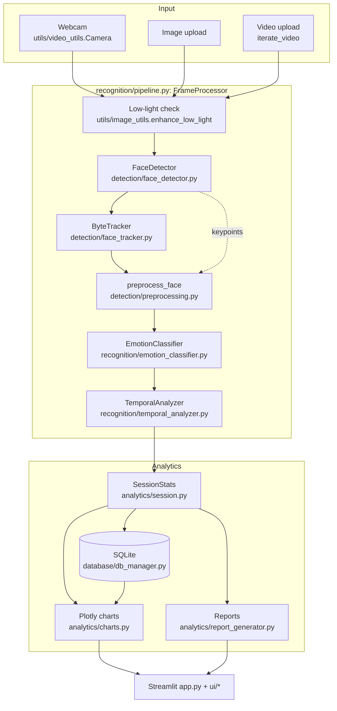
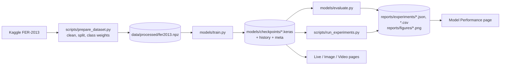
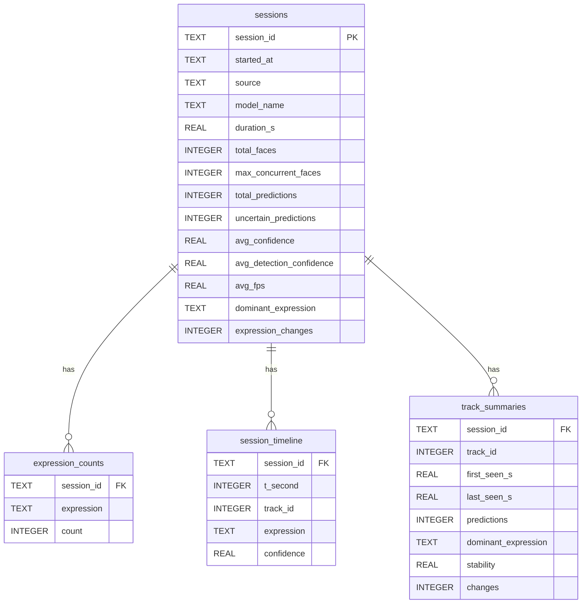

# EmotionLens AI: Architecture and technical documentation

## 1. System overview

Offline components:

## 2. Module responsibilities and contracts

| Module | Responsibility | Key interface |
|---|---|---|
| `config.py` | Paths, labels, training defaults, `AppSettings` dataclass persisted to `user_settings.json` | `load_settings()`, `save_settings()` |
| `utils/logger.py` | Console + rotating file logging | `get_logger(name)` |
| `utils/device.py` | Detect GPU/CPU once, enable memory growth | `configure_tensorflow() -> DeviceInfo` |
| `utils/video_utils.py` | Camera context manager (always releases), FPS EMA, video IO with codec fallback | `Camera`, `FPSMeter`, `iterate_video`, `create_video_writer` |
| `utils/image_utils.py` | Brightness, low-light enhancement, overlays | `enhance_low_light`, `draw_results` |
| `models/cnn_model.py` | Model builders; both models take **(N,48,48,1) float in [0,255]** and output 7 softmax probabilities | `build_custom_cnn`, `build_mobilenetv2` |
| `models/train.py` | Training with class weights, EarlyStopping, ReduceLROnPlateau, ModelCheckpoint, timing | CLI |
| `models/evaluate.py` | Accuracy, macro/weighted P/R/F1, confusion matrix, latency, comparison table | CLI |
| `detection/face_detector.py` | MediaPipe BlazeFace, Haar fallback, downscaled detection | `FaceDetector.detect(frame) -> list[Detection]` |
| `detection/face_tracker.py` | ByteTrack | `ByteTracker.update(boxes, scores) -> list[TrackOutput]` |
| `detection/preprocessing.py` | Eye alignment + crop in one affine warp, dark-face enhancement | `preprocess_face(frame, det) -> uint8 48x48` |
| `recognition/emotion_classifier.py` | Load checkpoint, `tf.function` batched inference | `predict_batch(list[48x48]) -> (N,7)` |
| `recognition/temporal_analyzer.py` | Per-track smoothing, hysteresis, stability, time per label | `update(track_id, probs, t) -> TemporalResult` |
| `recognition/pipeline.py` | Orchestrates everything per frame, frame skipping, error isolation | `FrameProcessor.process(frame, t)` |
| `analytics/session.py` | Accumulates labels/confidences/timeline in memory | `summary()`, `per_second_df()` |
| `database/db_manager.py` | SQLite CRUD with cascading deletes | `save_session`, `delete_session`, `list_sessions` |
| `ui/*.py` | One module per page, each exposing `render()` | |

**Why the model contains its own preprocessing.** Normalisation, augmentation and (for MobileNetV2)
upsampling + gray→RGB are Keras layers inside the saved model. The runtime only has to hand over a
48×48 grayscale crop, so swapping the CNN for MobileNetV2 changes nothing in the pipeline, and there is
no risk of training/serving skew from re-implementing normalisation in two places.

### Training/serving split (ONNX)

Training happens on a GPU machine (Colab) with TensorFlow/Keras. `models/export_onnx.py` converts each
checkpoint to ONNX (opset 17). It first rebuilds the architecture without the augmentation block and copies
the trained weights in, because Keras' random augmentation layers leave stateless random ops in the traced
graph that tf2onnx rejects. It then uses Keras' `model.export(format="onnx")` and records the maximum probability
difference and label agreement against Keras on 1,000 test images. The app loads `<name>.onnx` with
ONNX Runtime (`recognition/emotion_classifier.py`, backend "onnx"); a Keras backend with the same
interface remains for machines where TensorFlow works. Motivation: Windows Smart App Control blocks
TensorFlow's unsigned native DLLs on the target laptop, whereas ONNX Runtime is Microsoft-signed, a far
smaller dependency, and has fast CPU kernels. `utils/native_preload.py` loads MediaPipe/ONNX Runtime
before pyarrow, whose bundled older `msvcp140.dll` otherwise breaks MediaPipe's DLL initialisation.

## 3. Algorithms

### 3.1 Face detection
MediaPipe BlazeFace is a single-shot detector built for mobile GPUs/CPUs. It returns a box, a score
and 6 keypoints (eyes, nose tip, mouth, ear tragions). Frames wider than `detection_input_width`
are downscaled before detection and boxes are mapped back, which bounds detector cost regardless of
camera resolution. If MediaPipe cannot initialise, an OpenCV Haar cascade takes over. It has no
calibrated score (reported as "n/a") and no keypoints (alignment is skipped).

**Detection failure handling.** If no face is found on a dim frame (brightness < 1.5 × threshold), the
pipeline retries once on an enhanced frame. Exceptions in a frame are logged and that frame returns no
faces, so a live session never crashes on one bad frame.

### 3.2 Low-light enhancement
`enhance_low_light` picks a gamma so the mean brightness moves toward a target
(`gamma = log(target/255) / log(mean/255)`, clipped to [0.35, 1]), then applies CLAHE to the L channel
of LAB (colour preserved) or directly to grayscale crops. It runs only when the frame/face is darker
than `low_light_threshold`, because the classifier was trained on unenhanced FER images and always
enhancing would shift the input distribution (`run_experiments preprocessing` measures this).

### 3.3 Face alignment
The roll angle is `atan2(dy, dx)` between the eye keypoints (ordered by x so mirrored frames behave
identically). A single affine matrix (rotation about the face centre × scale to 48 px, plus
translation to the output centre) is applied with `cv2.warpAffine` on a region of interest around the
face. Only the 48×48 output is rendered, so alignment costs well under a millisecond per face. Angles above 30° are treated as
keypoint errors. Large faces are Gaussian-blurred before the single-step downscale to avoid aliasing.

### 3.4 ByteTrack multi-face tracking
State per track: Kalman filter over `[cx, cy, w, h, vcx, vcy, vw, vh]` with a constant-velocity
model, process/measurement noise scaled by box height (as in DeepSORT/ByteTrack).

Per frame:
1. Predict all tracks.
2. Split detections: high (≥ `track_high_thresh`) and low (≥ `track_low_thresh`).
3. Associate high detections with **all** tracks (active + lost) via Hungarian assignment on `1 − IoU`
   with a minimum IoU. Lost tracks matched here keep their ID, which handles brief occlusions.
4. Associate low detections with remaining **active** tracks (IoU ≥ 0.5). This is ByteTrack's key idea:
   a blurred or partly occluded face gets a low detector score, but it still continues an existing
   track instead of being thrown away.
5. Unmatched tracks: `lost_frames += 1`; deleted after `track_max_lost` processed frames.
   Unconfirmed (tentative) tracks are deleted immediately.
6. Unmatched high detections ≥ `track_new_thresh` start tentative tracks, confirmed after
   `track_min_hits` matches (immediately on the first frame).

Why not DeepSORT: it adds an appearance-embedding CNN, which means computing a biometric face
descriptor per face per frame, an extra model and extra latency. The privacy requirement rules
out storing embeddings, and for faces in a webcam scene motion + IoU are usually sufficient.
Trade-off: if two people cross paths or someone leaves and returns after `max_lost` frames, IDs can
switch or be re-issued, because nothing ties an ID to an identity.

### 3.5 Expression classification
- **Custom CNN**: 4 VGG-style blocks of (Conv3×3-BN-ReLU)×2 + MaxPool + Dropout (64→128→256→256
  channels, 48→3 px), Flatten, Dense-256-BN-ReLU-Dropout(0.5), Dense-7-softmax, L2 1e-4. About 2.9M
  parameters.
- **MobileNetV2 transfer**: in-model upsampling to 96×96, gray→RGB, scaling to [−1, 1], ImageNet
  backbone, GAP + Dense-256 head. Stage 1 trains the head with the backbone frozen (LR 1e-3); stage 2
  unfreezes the top 40 layers except BatchNorm and fine-tunes with LR 1e-4. The backbone is called with
  `training=False` so BN statistics stay frozen. Fine-tuning BN on small batches of a very different domain
  destabilises it.
- **Training**: Adam, sparse categorical cross-entropy, balanced class weights
  `w_c = N / (K · n_c)`, augmentation (flip, ±22° rotation, zoom, shift, contrast, brightness),
  EarlyStopping (val_loss, patience 8, restore best), ReduceLROnPlateau (×0.5, patience 3),
  ModelCheckpoint (best val_accuracy).
- **Inference optimisation**: one batched forward pass for all faces in a frame; `tf.function` with a
  fixed input signature (traced once); warm-up at load; frame skipping; detection on downscaled frames.

### 3.6 Temporal analysis
For each track:
- **Smoothing**: EMA `s_t = α p_t + (1 − α) s_{t−1}` (default α = 0.35, about a 5-frame effective memory)
  or a moving-window mean.
- **Hysteresis**: the displayed (stable) label switches only after a different class has been the top
  smoothed class for `change_min_persist` consecutive updates; each switch is a `ChangeEvent`.
- **Uncertainty**: if the smoothed probability of the stable label is below the expression confidence
  threshold, the label is shown as *Uncertain*.
- **Stability**: share of the last `stability_window` raw argmax labels equal to the stable label.
- **Time distribution**: seconds spent per stable label (gaps > 1 s, e.g. occlusion, are not counted).

These are statistics of model outputs, not inferences about inner states.

## 4. Data model (SQLite)

The timeline is down-sampled to one row per second per track (most frequent label, mean confidence)
to keep the database small; the full-resolution timeline is only kept in memory for the latest session.
`ON DELETE CASCADE` + `PRAGMA foreign_keys = ON` make deleting a session remove all of its rows.

## 5. Streamlit execution model

Streamlit re-runs `app.py` top to bottom on every interaction. Consequences handled in the code:
- Expensive objects (`EmotionClassifier`, `DatabaseManager`) are cached with `st.cache_resource`.
- Live state (`FrameProcessor`, `SessionStats`) lives in `st.session_state` so it survives reruns.
- The webcam loop runs inside `with Camera(...)`. Toggling *Start camera* off makes Streamlit interrupt
  the script; the context manager releases the device, and the next run saves the session.
- Image results are cached by `md5(bytes) + settings` so reruns do not re-analyse or double-save.

## 6. Configuration reference

All runtime settings live in `config.AppSettings` and are editable on the **Settings** page
(persisted to `user_settings.json`). Most important:

| Setting | Default | Effect |
|---|---|---|
| `detection_confidence` | 0.5 | min face-detector score |
| `expression_confidence_threshold` | 0.40 | below → *Uncertain* |
| `frame_skip` | 1 | inference every 2nd frame |
| `smoothing_method` / `ema_alpha` | ema / 0.35 | responsiveness vs. stability |
| `change_min_persist` | 3 | hysteresis length |
| `track_high_thresh` / `track_iou_thresh` | 0.6 / 0.3 | association gates |
| `track_max_lost` | 30 | frames a lost face can come back with the same ID |
| `low_light_threshold` | 70 | brightness below which enhancement runs |

## 7. Evaluation methodology

- Test metrics come from the untouched FER-2013 test split (PrivateTest in the CSV layout), so the numbers
  are comparable with the literature. Train is cleaned of blanks, duplicates and test-identical images.
- Report **macro-F1** alongside accuracy: with a 16:1 class imbalance, accuracy is dominated by
  *Happy*/*Neutral*.
- Latency: median and p95 over 100 timed runs after 10 warm-up runs, for batch sizes 1/4/8 on the
  machine that ran the evaluation (device recorded in the JSON).
- Experiments (`scripts/run_experiments.py`): synthetic low light, preprocessing ablation, smoothing
  on synthetic jitter sequences, multi-face latency on tiled frames, training ablations.
  Each writes a notes file stating its method and limitations.

## Limitations and fairness

- **Dataset bias.** FER-2013 was collected via web image search. Its demographic composition is not
  documented or balanced, and published audits of facial-analysis systems report accuracy gaps across
  skin tone, gender and age. This project cannot measure such gaps because FER-2013 has no demographic
  labels. Do not deploy it for decisions about people.
- **Label noise and ambiguity.** Human agreement on FER-2013 labels is far from perfect, and categories
  such as Fear/Surprise or Sad/Neutral overlap. This caps achievable accuracy.
- **Domain shift.** FER images are 48×48, mostly frontal and often posed. Webcam faces differ in
  resolution, pose, lighting, occlusion (glasses, masks) and spontaneity, so expect lower real-world
  accuracy than test accuracy.
- **Expression ≠ emotion.** Facial movements are culturally modulated and context dependent; the same
  expression can accompany different feelings and vice versa.
- **Tracking identity.** IDs are anonymous and per session; ID switches can occur when faces cross.
- **Hardware.** Latency and FPS figures depend on the CPU and are only valid for the machine measured.
